  

**We build, host and continuously improve websites for small and medium-sized businesses.** 
*From the first design to long-term growth: one team, one partner.*

 

## ✨ What we do

<table>
<tr>
<td width="33%" valign="top" align="center">

### 🛠️ Build
Custom-designed websites that fit your brand, your goals and your customers. No templates, no one-size-fits-all.

</td>
<td width="33%" valign="top" align="center">

### ☁️ Host
We take care of hosting: uptime, updates, security and backups, so you never have to think about servers.

</td>
<td width="33%" valign="top" align="center">

### 📈 Grow
We track your traffic and visitor behavior, share clear insights, and keep improving your site based on real data.

</td>
</tr>
</table>

 

## 🔄 How we work with you

  

<table>
<tr>
<td width="50%" valign="top">

#### 🤝 1. Intake
We get to know your business, your customers and your goals, so the website is built around what *you* need.

#### 🎨 2. Design & Build
We design and develop a site tailored to your brand, and you give feedback at every stage.

#### 🚀 3. Launch & Host
We put your site live and handle hosting, security, updates and backups from then on.

</td>
<td width="50%" valign="top">

#### 📊 4. Monitor
We track traffic and how visitors use your site, and share clear, jargon-free insights with you.

#### ⚡ 5. Improve
Based on the data and your feedback, we keep making your website better.

> **🔁 This is where the real value is.** 
> Steps 4 and 5 repeat for as long as we work together, so your website keeps growing with your business.

</td>
</tr>
</table>

 

## 💡 Why Signum Studios

| | |
|---|---|
| 🎯 **Made for SMEs** | We understand the needs and budgets of small and medium-sized businesses |
| 🧩 **Everything in one place** | Design, development, hosting and analytics from a single team |
| 📊 **Data-driven** | Decisions based on how real visitors use your site, not guesswork |
| 🔁 **Long-term partnership** | We keep improving your site as your business grows |

 

## 📬 Let's work together

Looking for a website that grows with your business?

 

Made with 💙 by the Signum Studios team

